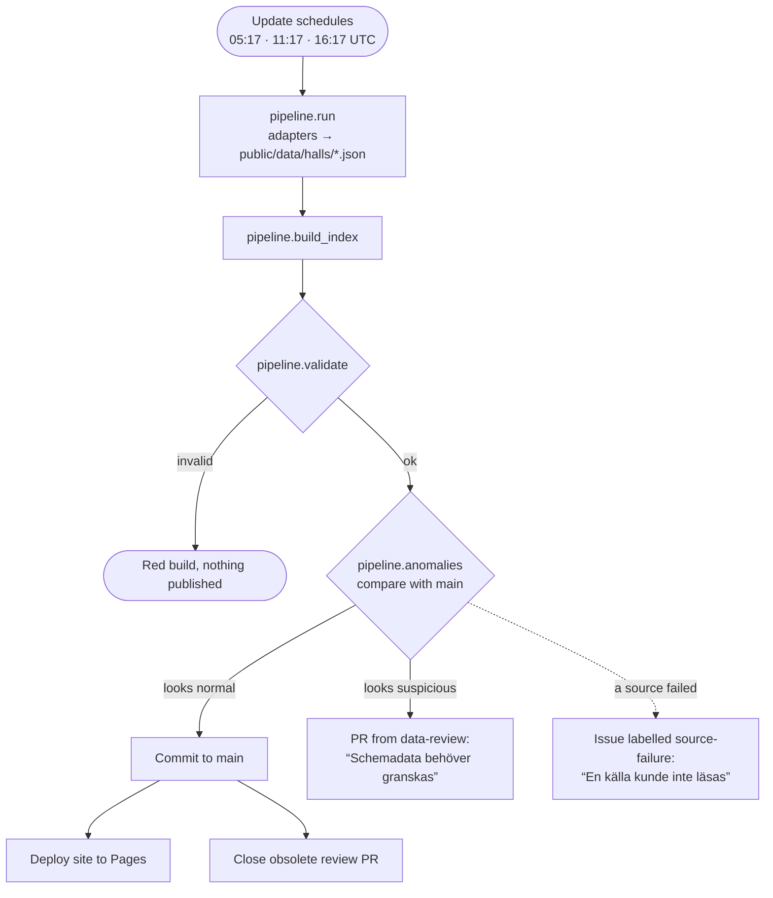
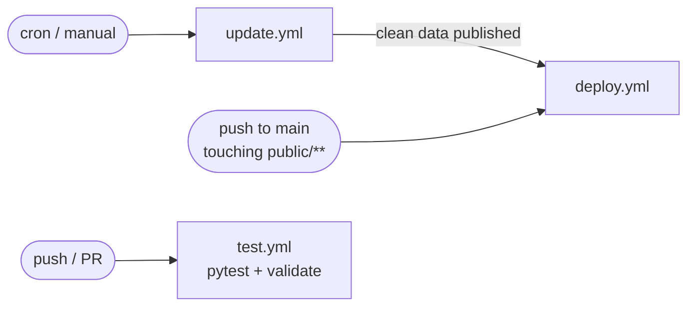

# Allmänhetens åkning

Public-skating times for the ice rinks in **Stockholms stad** and **Tyresö kommun**,
updated three times a day and published at <https://vlinder.github.io/ice-ice-baby/>
with a list per day, a timeline, a week overview and a map. Every time links back to
the page it was read from.

## Sources

| Source | Adapter | Notes |
|---|---|---|
| [motionera.stockholm/skridskoakning](https://motionera.stockholm/skridskoakning/) | `adapters/stockholm_motionera.py` | Weekly lists, usually current + next week |
| [Tyresö: Rbok information board](https://tyreso.rbok.se/informationstavla?id=fbe27841-479e-4387-8e40-9b6a158436c4) | `adapters/tyreso_rbok.py` | Linked from tyreso.se; about two weeks ahead, includes holiday times |

Hall names, short names and coordinates live in `config/halls.json`.
[SPEC.md](SPEC.md) describes the data format, the adapter contract and the review rules.

## How it works

The **Update schedules** workflow runs at 05:17, 11:17 and 16:17 UTC.



A failing source only marks its own halls as stale ("kan vara inaktuell") and never blocks
the other sources. Source failures are reported on top of the normal or suspicious path.

The workflows and what triggers them:



## Day-to-day

- **Nothing to do** while builds are green.
- **A PR titled "Schemadata behöver granskas"**: the new data looks odd. Read the report
  in the PR, compare with the source, and merge if correct (or fix the adapter).
- **An issue "En källa kunde inte läsas"**: a source failed. If it keeps failing, the page
  layout has probably changed. Save the new HTML as a fixture, fix the parser, and close
  the issue.
- **A red "Validate" step**: the output broke the spec, and nothing was published.
- **Dependabot PRs** arrive on Mondays, one for Python packages and one for actions.
  Merge them when the Tests check is green.

## Repository settings

These must be set for the workflows to work:

- **Settings → Pages → Source:** GitHub Actions.
- **Settings → Actions → General → Workflow permissions:** *Read and write permissions*, with
  *Allow GitHub Actions to create and approve pull requests* ticked (for review PRs).

## Local development

```bash
pip install -r requirements.txt
python -m pytest -q                       # parser tests against saved fixtures
python -m pipeline.run                    # fetch live data
python -m pipeline.build_index
python -m pipeline.validate
python -m pipeline.anomalies              # compare with git HEAD
python -m http.server -d public 8000      # open http://localhost:8000
```

## Adding a hall or a municipality

- **New hall in an existing source:** it is picked up automatically and flagged for review.
  Add its name, short name and coordinates to `config/halls.json`.
- **New municipality:** write `adapters/<name>.py` following the contract in SPEC.md,
  save a fixture, add tests, register it in `adapters/__init__.py`, and add its halls to
  `config/halls.json`.

## Notes

- Coordinates in `config/halls.json` are approximate.
- Map tiles come from OpenStreetMap under their
  [tile usage policy](https://operations.osmfoundation.org/policies/tiles/).
- This is an unofficial compilation. Municipalities can change times at short notice.
