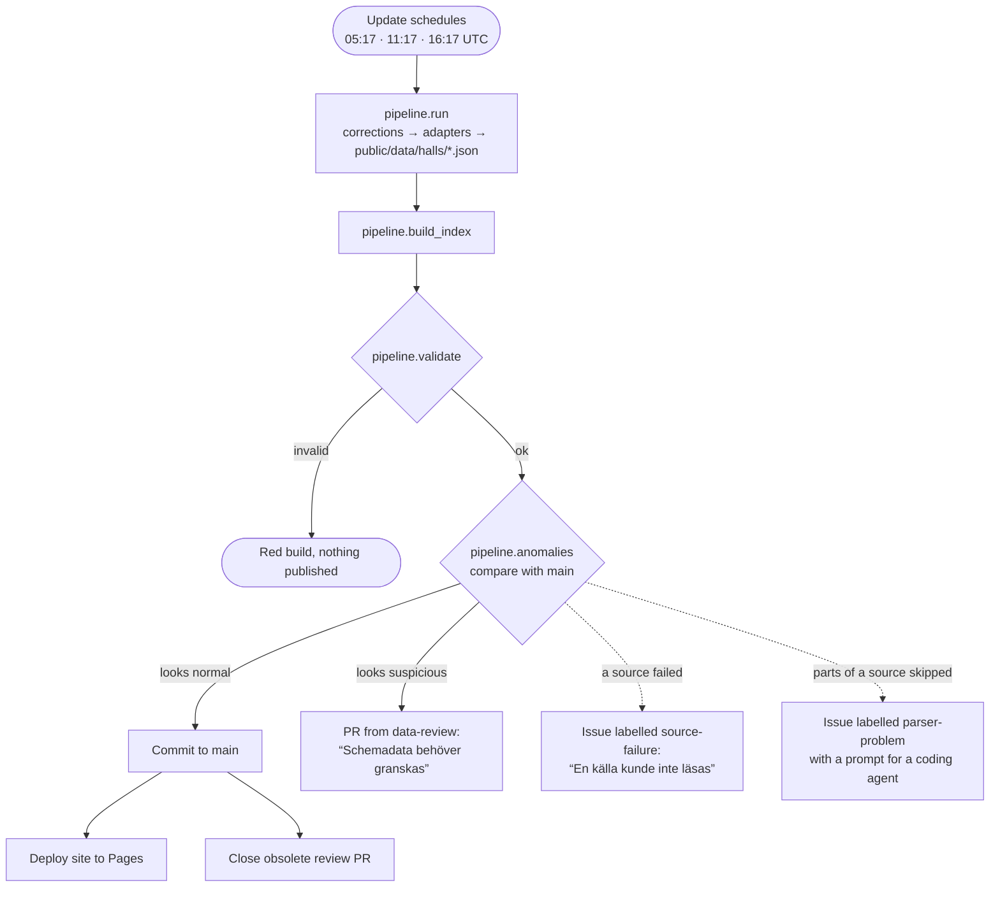

# Allmänhetens åkning

Public-skating times for the ice rinks in **Stockholm County** (25 of its 26
municipalities), updated three times a day and published at
<https://vlinder.github.io/ice-ice-baby/> with a list per day, a timeline, a week overview
and a map. Every time links back to the page it was read from.

## Sources

The sources are the pages each municipality points to (the same ones
[skridskor.nu](https://skridskor.nu/status/) links as "Källa").

| Municipality | Adapter | Source |
|---|---|---|
| Stockholm | `stockholm_motionera` | [motionera.stockholm](https://motionera.stockholm/skridskoakning/), weekly lists |
| Botkyrka, Haninge, Nacka, Norrtälje, Tyresö, Vallentuna | `*_rbok` → `rbok.py` | Rbok information boards (Haninge: one per hall) |
| Södertälje | `sodertalje_frigo` → `frigo.py` | FRI-GO booking lists, one per rink, 7 days |
| Ekerö | `ekero_interbook` | Interbook booking list linked from ekero.se, 60 days (moved from FRI-GO in Nov 2026) |
| Salem | `salem_sportadmin` | IFK Salem's SportAdmin page, linked by the municipality |
| Vaxholm | `vaxholm_actor` | Actor Smartbook export grid |
| Danderyd, Huddinge, Järfälla, Lidingö, Nynäshamn, Sigtuna, Sollentuna, Solna, Sundbyberg, Täby, Upplands-Bro, Upplands Väsby, Värmdö, Österåker | `<kommun>_web` | The municipality's own web page (weekly schedules, holiday blocks, exceptions) |
| Nykvarn | – | No published times (natural ice only) |

Some sources are empty on purpose right now (Södertälje's lists, Vaxholm's export,
Upplands-Bro's outdoor rink between seasons). Their adapters recognise the "no times"
message and say so (`empty_reason`), instead of being flagged as broken.

Hall names, short names and coordinates live in `config/halls.json`.
[SPEC.md](SPEC.md) describes the data format, the adapter contract and the review rules.

## How it works

The **Update schedules** workflow runs at 05:17, 11:17 and 16:17 UTC.



A failing source only marks its own halls as stale ("kan vara inaktuell") and never blocks
the other sources. A line a parser cannot read is skipped, the rest is published, and the
hall is marked "tider kan saknas". Source failures are reported on top of the normal or suspicious path.

The workflows and what triggers them:


## Day-to-day

- **Nothing to do** while builds are green.
- **A PR titled "Schemadata behöver granskas"**: the new data looks odd. Read the report
  in the PR, compare with the source, and merge if correct (or fix the adapter).
- **An issue "Källan kunde inte läsas helt: …"** (label `parser-problem`): part of a source
  could not be read and was skipped; everything else was published, and the hall shows
  "tider kan saknas" on the site. Glance at the source, then paste the prompt from the issue
  into Claude Code (or another coding agent). It adds a correction to
  `config/corrections.json` for a typo, or fixes the parser, and opens a PR. The issue closes
  itself once a run reads the source cleanly.
- **An issue "En källa kunde inte läsas"**: a source failed. If it keeps failing, the page
  layout has probably changed. Save the new HTML as a fixture, fix the parser, and close
  the issue.
- **A red "Validate" step**: the output broke the spec, and nothing was published.
- **Dependabot PRs** arrive on Mondays, one for Python packages and one for actions.
  Merge them when the Tests check is green.

## Repository settings

These must be set for the workflows to work:

- **Settings → Pages → Source:** GitHub Actions.
- **Settings → Actions → General → Workflow permissions:** *Read and write permissions*, with
  *Allow GitHub Actions to create and approve pull requests* ticked (for review PRs).

## Local development

```bash
pip install -r requirements.txt
python -m pytest -q                       # parser tests against saved fixtures
python -m pipeline.run                    # fetch live data
python -m pipeline.build_index
python -m pipeline.validate
python -m pipeline.anomalies              # compare with git HEAD
python -m http.server -d public 8000      # open http://localhost:8000
```

## Adding a hall or a municipality

- **New hall in an existing source:** it is picked up automatically and flagged for review.
  Add its name, short name and coordinates to `config/halls.json`.
- **New municipality:** if it uses Rbok or FRI-GO, add a small module with its board/list
  URLs and hall mapping (copy e.g. `nacka_rbok.py`). Otherwise write `adapters/<name>.py`
  following the contract in SPEC.md, using the helpers in `adapters/common.py`. Either way:
  save a fixture, add tests, register it in `adapters/__init__.py`, and add its halls to
  `config/halls.json`.
- **A hand-written page changed:** its adapter raises `ParseError` (source-failure issue)
  or warns (review PR). Save the new page over the fixture, adjust the parser, and run
  `python -m pytest -q`.

## Notes

- Coordinates in `config/halls.json` are approximate.
- Map tiles come from OpenStreetMap under their
  [tile usage policy](https://operations.osmfoundation.org/policies/tiles/).
- This is an unofficial compilation. Municipalities can change times at short notice.
